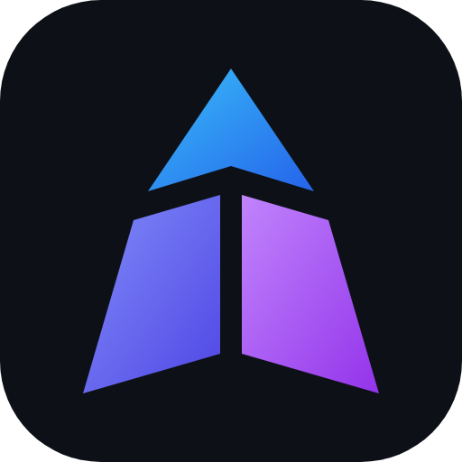

<p align="center">
  
</p>

<h1 align="center">Antigravity Tools</h1>

<p align="center">
  <strong>A local-first, modular developer productivity plugin for <a href="https://antigravity.google/docs/plugins/">Google Antigravity</a> featuring a Prompt Library, AI Strategic Roadmap Planner, Codebase Ideation & Security Auditor, and Agency Agents Integration Hub.</strong>
</p>

<p align="center">
  <a href="https://antigravity.google/docs/plugins/"></a>
  <a href="./package.json"></a>
  <a href="https://nodejs.org/"></a>
  <a href="https://www.typescriptlang.org/"></a>
  <a href="https://modelcontextprotocol.io/"></a>
  <a href="./package.json"></a>
  <a href="#-development--testing"></a>
</p>

---

## 📑 Table of Contents

- [Why Antigravity Tools?](#-why-antigravity-tools)
- [Core Modules & Features](#-core-modules--features)
  - [1. Prompt Library & Dynamic Clipboard Injection](#1--prompt-library--dynamic-clipboard-injection)
  - [2. AI Strategic Roadmap & Competitor Planner](#2-️-ai-strategic-roadmap--competitor-planner)
  - [3. Codebase Ideation, Performance & Security Audits](#3--codebase-ideation-performance--security-audits)
  - [4. Agency Agents Integration & Multi-Agent Handoff](#4--agency-agents-integration--multi-agent-handoff)
  - [5. Multi-Project Workspace Switcher](#5--multi-project-workspace-switcher)
- [Installation](#-installation)
  - [Prerequisites](#prerequisites)
  - [Option A: Install as a Google Antigravity Plugin (Recommended)](#option-a-install-as-a-google-antigravity-plugin-recommended)
  - [Option B: Connect MCP Server Only (Without Sidecar UI)](#option-b-connect-mcp-server-only-without-sidecar-ui)
  - [Option C: Standalone Web Dashboard & CLI](#option-c-standalone-web-dashboard--cli)
  - [Updating the Plugin](#updating-the-plugin)
- [Configuration, AI Modes & Local Data Storage](#-configuration-ai-modes--local-data-storage)
  - [Analysis Modes](#analysis-modes)
  - [Environment Variables](#environment-variables)
  - [Local Storage Layout](#local-storage-layout)
- [Usage Guide](#-usage-guide)
  - [Method 1: Antigravity Sidecar Aux Pane](#method-1-antigravity-sidecar-aux-pane)
  - [Method 2: Autonomous AI Agent Execution (23 MCP Tools)](#method-2-autonomous-ai-agent-execution-23-mcp-tools)
  - [Method 3: Standalone Local Web Dashboard](#method-3-standalone-local-web-dashboard)
  - [Method 4: Command-Line Interface (CLI)](#method-4-command-line-interface-cli)
- [Architecture & Directory Structure](#-architecture--directory-structure)
  - [Extending with New Modules](#extending-with-new-modules)
- [Development & Testing](#-development--testing)
- [Troubleshooting](#-troubleshooting)
- [License](#-license)

---

## 🌟 Why Antigravity Tools?

Antigravity Tools brings four engineering productivity workflows into a single **local-first** TypeScript/Node.js plugin with zero third-party runtime dependencies:

- **Four Surfaces, One Core**: Use the interactive **Antigravity Sidecar Aux Pane**, call any of **23 MCP tools** from your AI agent, run the **Standalone Web Dashboard** (`http://localhost:4321`), or automate via the **CLI**.
- **Zero Runtime Dependencies**: Built exclusively on Node.js (`18+`) and TypeScript (`5.7+`) — works across **Windows**, **macOS**, and **Linux** without external package bloat.
- **Read-Only Project Scanning & Workspace Isolation**: Per-project discovery, competitor insights, roadmaps, and ideation reports are saved inside `~/.gemini/antigravity-toolkit/workspaces/<slug>_<hash>/`. Scanning a repository never creates or modifies files inside that repo unless you explicitly click **Export** (`ROADMAP.md` / `IDEATION.md`) or run **Agency Integration**.
- **Silent Background Workers**: Codebase scans run inside isolated Node.js `worker_threads` ([`src/modules/ai/scan-worker.ts`](./src/modules/ai/scan-worker.ts)), keeping the sidecar HTTP server responsive without spawning extra visible conversations in your Antigravity sidebar.
- **Offline-First with Optional Gemini AI**: Works immediately offline using built-in **Deep Code Comprehension**, or upgrades automatically when a Gemini API key is configured (`GEMINI_API_KEY`) or an AI agent saves reports directly via MCP.
- **Sandboxed Sidecar Clipboard Bridge**: Copying prompts inside restricted sidecar iframes routes through `POST /api/clipboard` ([`src/web/server.ts`](./src/web/server.ts)) and native OS utilities (`Set-Clipboard` / `clip.exe` on Windows, `pbcopy` on macOS, `wl-copy` / `xclip` / `xsel` on Linux).

---

## 🧩 Core Modules & Features

```text
┌─────────────────────────────────────────────────────────────────────────────────────────┐
│                                   ANTIGRAVITY TOOLS                                     │
├──────────────────────┬──────────────────────────┬───────────────────────┬───────────────┤
│ 📚 PROMPT LIBRARY    │ 🗺️ STRATEGIC ROADMAP     │ 💡 CODEBASE IDEATION  │ 🤖 AGENCY HUB │
├──────────────────────┼──────────────────────────┼───────────────────────┼───────────────┤
│ • {{var}} Templates  │ • Codebase Introspection │ • Feature Ideas (ci)  │ • 280+ Agents │
│ • {{var:default}}    │ • Competitor Benchmarks  │ • Perf Audits (perf)  │ • /pipeline   │
│ • Live Preview Modal │ • 3-Phase MoSCoW Plan    │ • Security (sec / CWE)│ • [CALL_AGENT]│
│ • Native OS Paste    │ • Status & Delete Ctrl   │ • Quality & Tech Debt │ • Registry MD │
│ • JSON Import/Export │ • Export ROADMAP.md      │ • 0-100 Health Scores │ • Quick Prompts│
│ • 8 MCP Tools        │ • 7 MCP Tools            │ • 5 MCP Tools         │ • 3 MCP Tools │
└──────────────────────┴──────────────────────────┴───────────────────────┴───────────────┘
```

### 1. 📚 Prompt Library & Dynamic Clipboard Injection
- **Smart Template Variables**: Write reusable prompts with `{{variable}}` or fallback defaults `{{variable:defaultValue}}`. Variables are auto-detected on save and rendered in an interactive split-pane modal with a live preview and character counter.
- **One-Click System Clipboard Paste**: Fill placeholders and inject rendered prompts straight into your OS clipboard (`Ctrl+V` ready in chat or editor), backed by the server-side clipboard bridge inside Antigravity sidecar iframes.
- **Curated Starter Seeds**: Ships with 5 pre-seeded engineering prompts (`code-review-senior`, `systematic-debugging`, `tdd-feature-implement`, `clean-refactoring`, `architecture-rfc`).
- **Search, Organization & Backup**: Instant search (`Ctrl+K`), category pills, tags, ⭐ favorites toggle, usage counter, and JSON import/export with `merge` or `replace` modes.

### 2. 🗺️ AI Strategic Roadmap & Competitor Planner
Inspired by the autonomous planning architecture in [AndyMik90/Aperant](https://github.com/AndyMik90/Aperant):
- **Automated Project Discovery (`🔬 Scan`)**: Inspects manifests (`package.json`, `pyproject.toml`, `Cargo.toml`, `go.mod`, etc.), source files, and documentation to detect primary language, frameworks, project type, target personas, existing capabilities, and feature gaps.
- **Competitor Intelligence (`🥊 Rivals`)**: Benchmarks direct and indirect market alternatives, extracting pain points with severity/impact ratings (`CP-xx`) and market differentiation gaps (`GAP-xx`).
- **3-Phase MoSCoW Roadmap (`⚡ Generate Roadmap`)**: Synthesizes discovery and competitor gaps into a phased **Must / Should / Could / Won't** board:
  - *Phase 1: Foundation & Core Experience*
  - *Phase 2: Competitor Differentiation & Workflow Power*
  - *Phase 3: Scale, Ecosystem & Autonomous Intelligence*
- **Interactive Feature Controls**: Update feature status (`idea`, `planned`, `in_progress`, `completed`), filter by MoSCoW priority, review user stories and acceptance criteria, copy ready-to-run AI implementation prompts (**Copy Prompt for Feature**), delete individual features (**🗑️ Delete**), or clear the workspace's roadmap, discovery, and competitor data (**🗑️ Delete** in the toolbar).
- **Publication-Ready Export (`📄 Export`)**: Writes a structured `ROADMAP.md` directly to the active project root.

### 3. 💡 Codebase Ideation, Performance & Security Audits
A 4-pillar static analysis and opportunity discovery engine:
1. **🚀 Code-Revealed Feature Discoveries (`ci-xxx`)**: Feature ideas grounded in your project's real modules and extension points.
2. **⚡ Performance Optimizations (`perf-xxx`)**: Flags blocking synchronous I/O, caching opportunities, and runtime/bundle bottlenecks.
3. **🛡️ Security Hardening (`sec-xxx`)**: Audits for path traversal (`CWE-22`), hardcoded credentials (`CWE-798`), permissive CORS (`CWE-942`), unsafe eval/DOM patterns, and authorization gaps.
4. **🧹 Code Quality & Tech Debt (`cq-xxx`)**: Identifies oversized files, duplication, typing gaps, and missing test coverage.

Additional Ideation capabilities:
- **0–100 Health Scores Strip**: Live quantitative scores across **Security**, **Perf**, **Quality**, and **Ideas**, recalculated automatically after audits or item deletions.
- **Promote to Roadmap**: Convert any finding (`ci-xxx`, `perf-xxx`, `sec-xxx`, `cq-xxx`) into an active feature card on your MoSCoW roadmap with **➕ Promote to Roadmap**.
- **Prompt Copying, Deletion & Export**: Copy an implementation/remediation prompt for any finding (**Copy Prompt**), remove individual findings (**🗑️ Delete**), clear the workspace report (**🗑️ Delete**), or export `IDEATION.md` (**📄 Export IDEATION.md**).

### 4. 🤖 Agency Agents Integration & Multi-Agent Handoff
Native TypeScript bridge for the 280+ specialist skills from [Agency Agents](https://github.com/msitarzewski/agency-agents-app):
- **Auto-Discovery (`🔄 Re-Scan`)**: Scans `~/.gemini/config/skills`, `~/.gemini/antigravity/skills`, `.agents/skills`, and `skills/` to index installed `agency-*` skills and parse their frontmatter metadata.
- **1-Click Integration (`⚡ Integrate Agency`)**: Generates:
  - `docs/agency-registry.md` — master table of detected specialist agents, descriptions, and skill paths.
  - `.agents/workflows/agency-pipeline.md` — `/agency-pipeline` multi-agent squad router.
  - `.agents/rules/inter-agent-calling.md` — `[CALL_AGENT]` delegation protocol rule.
  - `agency-readme.md` — end-to-end guide with ready-to-use scenarios.
  - Injects 5 curated Agency workflow prompts into your Prompt Library.
- **Searchable Specialist Directory**: Search all detected specialists by slug or description, copy agent identifiers (**📋 Copy ID**), copy pre-formatted `[CALL_AGENT]` handoff blocks (**✨ Call Agent**), or launch Quick Prompt shortcuts (**🚀 New Project**, **✨ Add Feature**, **🔬 Research**, **🛡️ Reality Check**).

### 5. 📁 Multi-Project Workspace Switcher
- Displays the active project name and path in the persistent **📁 Project** header bar.
- **Sync**: Queries Antigravity conversation metadata via `/preload.js` and `/api/workspace` to snap to the active conversation's repository.
- **Change**: Point Antigravity Tools to any folder path on disk; Roadmap, Ideation, and Agency views refresh immediately using isolated workspace storage.

---

## 🛠️ Installation

### Prerequisites
- **Node.js**: `v18.0.0` or higher (`node -v`)
- **npm**: `v9.0.0` or higher (`npm -v`)
- **Git**: for cloning the repository
- **Google Antigravity IDE**: required for Sidecar Aux Pane and Plugin mode ([Antigravity Plugins Docs](https://antigravity.google/docs/plugins/))
- **Linux only (for clipboard copy)**: at least one clipboard CLI installed — `wl-copy` (Wayland), `xclip`, or `xsel`

---

### Option A: Install as a Google Antigravity Plugin (Recommended)

#### 1. Clone and Build
```bash
git clone https://github.com/spyshow/antigravity-tools.git
cd antigravity-tools
npm install
npm run build
```

*(Optional)* Verify everything compiles and passes all 30 tests:
```bash
npm test
```

#### 2. Copy Plugin Files to Antigravity's Global Plugins Directory

**Windows (PowerShell):**
```powershell
$target = "$env:USERPROFILE\.gemini\config\plugins\antigravity-tools"
New-Item -ItemType Directory -Path $target -Force | Out-Null

Copy-Item -Path "dist", "src", "skills", "rules", "sidecars", "assets", "bin", "plugin.json", "mcp_config.json", "package.json", "README.md" -Destination $target -Recurse -Force
```

**macOS / Linux (Bash):**
```bash
TARGET="$HOME/.gemini/config/plugins/antigravity-tools"
mkdir -p "$TARGET"
cp -R dist src skills rules sidecars assets bin plugin.json mcp_config.json package.json README.md "$TARGET"
```

> **Note:** Make sure `dist/` is included alongside `sidecars/`, because the sidecar entrypoint (`sidecars/prompt_library/dist/server.js`) imports compiled code from `dist/`.

#### 3. Enable the Plugin & Sidecar in Antigravity Config
Open `~/.gemini/config/config.json` (on Windows: `%USERPROFILE%\.gemini\config\config.json`) and ensure the plugin and sidecar entries are registered:

```json
{
  "plugins": {
    "antigravity-tools": {
      "enabled": true
    }
  },
  "sidecars": {
    "antigravity-tools/prompt_library": {
      "projectId": "default",
      "resolvedPermissions": null,
      "schemaVersion": 1
    }
  }
}
```

#### 4. Restart Antigravity
Restart Google Antigravity (or start a new session), click the **Plugins** icon in the right-hand Auxiliary Pane, and open **Antigravity Tools**.

---

### Option B: Connect MCP Server Only (Without Sidecar UI)

If you only want the 23 MCP tools in Antigravity or another MCP-compatible client, clone and build the repo first (`npm install && npm run build`), then add an entry to your MCP configuration pointing to `dist/mcp-server.js`:

```json
{
  "mcpServers": {
    "antigravity-toolkit": {
      "command": "node",
      "args": ["/absolute/path/to/antigravity-tools/dist/mcp-server.js"]
    }
  }
}
```

On Windows, use an escaped path such as `"C:\\path\\to\\antigravity-tools\\dist\\mcp-server.js"`.

---

### Option C: Standalone Web Dashboard & CLI

You can run the full 4-tab Web UI and CLI directly from your local clone without Antigravity:

```bash
# Start the local web dashboard (opens http://localhost:4321 automatically)
npm run ui

# Custom port or headless mode
node dist/cli.js ui --port 8080 --no-open
```

On Windows, you can also invoke the CLI via `bin\agy-tools.cmd` (or add `./bin` to your `PATH` / run `npm link`).

---

### Updating the Plugin

```bash
cd antigravity-tools
git pull
npm install
npm run build
```

Then re-run Step 2 of **Option A** to copy updated `dist`, `src`, `skills`, `rules`, `sidecars`, `assets`, `bin`, and manifest files into `~/.gemini/config/plugins/antigravity-tools`, and restart Antigravity.

---

## ⚙️ Configuration, AI Modes & Local Data Storage

### Analysis Modes
1. **Deep Code Comprehension (Default — Offline / Zero Config)**: Works out of the box with no API key. Parses manifests, file trees, symbols, routes, and security patterns to produce codebase-specific Roadmaps and Ideation reports.
2. **Gemini API Mode (Optional)**: When `GEMINI_API_KEY` or `GOOGLE_API_KEY` is configured (or saved via `~/.gemini/antigravity-toolkit/ai-settings.json` / `POST /api/ai/settings`), Roadmap and Ideation synthesis uses Gemini (`gemini-2.5-flash` by default) to generate deep code-aware JSON reports.
3. **Agent-Authored MCP Mode**: Your Antigravity AI agent can inspect files directly and persist custom findings via `roadmap_save_generated` and `ideation_save_generated`.

### Environment Variables

| Variable | Default | Purpose |
| :--- | :--- | :--- |
| `GEMINI_API_KEY` / `GOOGLE_API_KEY` | *(unset)* | Enables optional Gemini REST calls for Roadmap and Ideation synthesis. |
| `AGY_AI_MODEL` | `gemini-2.5-flash` | Overrides the Gemini model used for AI generation. |
| `AGY_AI_SETTINGS_PATH` | `~/.gemini/antigravity-toolkit/ai-settings.json` | Custom JSON file path for stored AI settings. |
| `AGY_PROMPTS_PATH` | `~/.gemini/antigravity-toolkit/prompts.json` | Custom JSON storage path for your Prompt Library. |
| `ANTIGRAVITY_SIDECAR_WEB_PORT` / `AGY_TOOLKIT_PORT` | `4321` | Preferred port for the Web/Sidecar HTTP server (automatically binds a free port if occupied). |

### Local Storage Layout

All plugin state lives under `~/.gemini/antigravity-toolkit/`:

```text
~/.gemini/antigravity-toolkit/
├── prompts.json                              # Saved & seed prompt templates
├── ai-settings.json                          # Optional Gemini API key & model config
└── workspaces/
    └── <projectSlug>_<sha1Hash10>/
        ├── discovery.json                    # Project Discovery analysis
        ├── competitors.json                  # Competitor intelligence & pain points
        ├── roadmap.json                      # 3-phase MoSCoW roadmap & feature statuses
        └── ideation.json                     # 4-pillar ideation & health score report
```

---

## 🚀 Usage Guide

### Method 1: Antigravity Sidecar Aux Pane

Open **Plugins → Antigravity Tools** in the right-hand Auxiliary Pane:

1. **Workspace Bar (`📁 Project`)**: Verify the active repository path, click **Sync** to match your open conversation workspace, or click **Change** to target any project folder.
2. **📚 Prompts Tab**:
   - Search (`Ctrl+K`) or filter by category/⭐ Favorites/tags.
   - Click **Paste** on any prompt card — fill `{{variables}}` in the modal (if present) and click **Copy & Paste to Clipboard**.
   - Use **+ New Prompt**, **Import**, and **Export** above the toolbar to manage your library.
3. **🗺️ Roadmap Tab**:
   - Click **⚡ Generate Roadmap** to run full discovery, competitor analysis, and MoSCoW synthesis in a silent background worker, or run **🔬 Scan** and **🥊 Rivals** individually.
   - Expand **Project & Market Intelligence** to inspect detected tech stack, gaps, and competitor pain points.
   - Filter by MoSCoW priority (`All`, `🔴 Must`, `🟡 Should`, `🟢 Could`, `⚪ Won't`), change feature statuses, click **Copy Prompt for Feature**, delete single features (**🗑️ Delete**), export `ROADMAP.md` (**📄 Export**), or clear the workspace's roadmap data (**🗑️ Delete**).
4. **💡 Ideation Tab**:
   - Review the live **Security / Perf / Quality / Ideas** score strip.
   - Click **💡 Run Ideation Audit** to run a fresh 4-pillar codebase audit.
   - Filter by `🚀 Features`, `⚡ Perf`, `🛡️ Security`, or `🧹 Quality`.
   - Click **➕ Promote to Roadmap**, **Copy Prompt**, or **🗑️ Delete** on any card, **📄 Export IDEATION.md** to save to disk, or **🗑️ Delete** in the toolbar to clear the report.
5. **🤖 Agency Tab**:
   - View detected specialist count and integration file checklist (`registry.md`, `pipeline.md`, `rules.md`, `readme.md`).
   - Click **⚡ Integrate Agency** to bootstrap Agency Agents files into your active workspace, or **🔄 Re-Scan** after installing new skills.
   - Launch **Quick Prompts** or search the directory to **📋 Copy ID** / **✨ Call Agent**.

---

### Method 2: Autonomous AI Agent Execution (23 MCP Tools)

Antigravity Tools registers **23 MCP tools** via `mcp_config.json`:

| Module | Tool Name | Description |
| :--- | :--- | :--- |
| **Prompts (8)** | `prompt_list` | List prompts with optional filters (`category`, `tag`, `search`, `favoriteOnly`). |
| | `prompt_get` | Fetch full template, metadata, and declared variables by ID or exact title. |
| | `prompt_search` | Quick keyword search across titles, descriptions, and templates. |
| | `prompt_render` | Interpolate `{{variables}}` without touching the clipboard. |
| | `prompt_paste` | Render template with variables and copy directly to the OS clipboard. |
| | `prompt_save` | Create or update a prompt; auto-detects `{{var}}` and `{{var:default}}`. |
| | `prompt_delete` | Delete a prompt from the library by ID. |
| | `prompt_categories` | List all categories, tags, and prompt counts. |
| **Roadmap (7)** | `roadmap_analyze_project` | Run codebase discovery (stack, personas, existing capabilities, gaps). |
| | `roadmap_analyze_competitors` | Benchmark competitors, user complaints, and market gaps. |
| | `roadmap_generate` | Run the full roadmap pipeline and save `roadmap.json` for the workspace. |
| | `roadmap_get` | Retrieve the saved roadmap, phases, features, and progress. |
| | `roadmap_update_feature` | Update feature status (`idea`, `planned`, `in_progress`, `completed`). |
| | `roadmap_export_markdown` | Write formatted `ROADMAP.md` to the workspace root. |
| | `roadmap_save_generated` | Persist an AI-authored `{ discovery, competitors, roadmap }` payload. |
| **Ideation (5)** | `ideation_analyze` | Run the 4-pillar audit (features, performance, security, code quality). |
| | `ideation_get` | Retrieve the current ideation report and health scores (generates if missing). |
| | `ideation_promote_to_roadmap` | Promote a finding (`ci-xxx`, `perf-xxx`, `sec-xxx`, `cq-xxx`) to the roadmap. |
| | `ideation_export_markdown` | Write formatted `IDEATION.md` to the workspace root. |
| | `ideation_save_generated` | Normalize and persist an AI-authored ideation report with calculated scores. |
| **Agency (3)** | `agency_integrate` | Generate `docs/agency-registry.md`, pipeline workflow, rules, readme, and prompts. |
| | `agency_list_agents` | List all installed `agency-*` specialist skills with paths and descriptions. |
| | `agency_status` | Inspect Agency integration status, generated files, and agent count. |

**Example Prompts to Give Your Antigravity Agent:**
- *"Inspect this repository and save a code-aware roadmap via `roadmap_save_generated`."*
- *"Audit the codebase for security and performance issues and export `IDEATION.md`."*
- *"Promote `sec-001` from ideation into the roadmap and mark `FEAT-01` as `in_progress`."*
- *"Find the `code-review-senior` prompt in my library and paste it with `language=TypeScript`."*
- *"Integrate my installed Agency Agents into this workspace."*

---

### Method 3: Standalone Local Web Dashboard

```bash
# Default port 4321 (auto-opens browser)
npm run ui

# Custom port without opening a browser automatically
node dist/cli.js ui --port 8080 --no-open
```

Then visit `http://localhost:4321` (or your chosen port) in any modern browser. Use the **Change** button in the **📁 Project** bar to inspect any project directory on disk.

---

### Method 4: Command-Line Interface (CLI)

```bash
# List all prompts (optionally filter by category)
node dist/cli.js list
node dist/cli.js list Review

# Render a prompt with variables and copy to OS clipboard
node dist/cli.js paste code-review-senior --var language=TypeScript --var target_code="src/web/server.ts"

# Print full prompt JSON definition
node dist/cli.js get systematic-debugging

# Start Web Dashboard or stdio MCP Server
node dist/cli.js ui --port 4321
node dist/cli.js mcp

# Show CLI help
node dist/cli.js help
```

---

## 📂 Architecture & Directory Structure

Conforms to the [Antigravity Plugins Specification](https://antigravity.google/schemas/v1/plugin.json):

```text
antigravity-tools/
├── plugin.json                     # Antigravity plugin manifest
├── mcp_config.json                 # MCP server stdio definition
├── package.json                    # Package metadata, bin, and npm scripts
├── tsconfig.json                   # TypeScript compiler config (ESM + ES2022)
├── assets/                         # Plugin logo & icon assets (PNG/SVG)
├── bin/
│   └── agy-tools.cmd               # Windows CLI wrapper
├── skills/                         # Built-in Antigravity agent skills
│   ├── ai-roadmap/SKILL.md
│   ├── ideation/SKILL.md
│   └── prompt-library/SKILL.md
├── rules/
│   └── prompt-library.md           # Agent behavioral rules for prompt reuse
├── sidecars/
│   └── prompt_library/             # Sidecar Aux Pane definition & static assets
│       ├── sidecar.json            # Sidecar process & entrypoint registration
│       ├── ui.html                 # Aux Pane HTML shell (loads /preload.js)
│       ├── index.html              # Dashboard HTML mirror
│       ├── app.js                  # Client UI controller
│       ├── styles.css              # Dark-theme UI styles
│       └── dist/server.js          # Sidecar launcher importing ../../../dist/
└── src/
    ├── types.ts                    # Shared PluginModule & MCP contracts
    ├── index.ts                    # Public package exports
    ├── cli.ts                      # CLI entrypoint (ui, mcp, list, paste, get)
    ├── mcp-server.ts               # JSON-RPC 2.0 MCP server over stdio
    ├── config.ts                   # Storage paths & port resolution
    ├── modules/
    │   ├── registry.ts             # Dynamic PluginModule & HTTP/MCP router
    │   ├── workspace.ts            # URI normalization & isolated storage dirs
    │   ├── prompts/                # Module 1: Prompt library, seeds, OS clipboard
    │   ├── roadmap/                # Module 2: Discovery, competitors, MoSCoW planner
    │   ├── ideation/               # Module 3: 4-pillar scanner, health scores, bridge
    │   ├── agency/                 # Module 4: Agency Agents detector & generator
    │   └── ai/                     # Worker threads runner, Gemini client, context builder
    ├── web/
    │   ├── server.ts               # HTTP server, /api/* dispatcher, /preload.js & clipboard bridge
    │   └── public/                 # Canonical web assets (synced to dist/web/public & sidecars/)
    └── tests/                      # Automated node:test suite (30 tests across 7 files)
        ├── agency.test.ts
        ├── ideation.test.ts
        ├── interpolator.test.ts
        ├── roadmap.test.ts
        ├── service.test.ts
        ├── storage.test.ts
        └── workspace.test.ts
```

### Extending with New Modules

All capabilities implement [`PluginModule`](./src/types.ts) and are wired into [`ModuleRegistry`](./src/modules/registry.ts):

1. Create `src/modules/<your-module>/index.ts` implementing `PluginModule` (`getTools`, `handleToolCall`, and optional `handleHttpRequest`).
2. Register it inside `ModuleRegistry` in [`src/modules/registry.ts`](./src/modules/registry.ts):
   ```typescript
   this.register(new YourModule());
   ```
3. Run `npm run build` (and `npm test`). Your MCP tools and `/api/*` endpoints are exposed automatically across MCP, CLI, Web UI, and Sidecar modes.

---

## 🧪 Development & Testing

```bash
# Compile TypeScript -> dist/ and copy static assets -> dist/web/public/
npm run build

# Watch mode during backend TypeScript development
npm run build:watch

# Build and run the full node:test suite (30 tests)
npm test
```

> **Frontend asset note:** [`src/web/public/`](./src/web/public/app.js) holds the canonical frontend files (`ui.html`, `index.html`, `app.js`, `styles.css`). If you edit frontend files, mirror them to [`sidecars/prompt_library/`](./sidecars/prompt_library/) and run `npm run build` so both standalone and sidecar views stay in sync.

---

## 🔧 Troubleshooting

- **Sidecar pane fails to load in Antigravity**: Confirm `npm run build` succeeded and that you copied `dist/` alongside `sidecars/` into `~/.gemini/config/plugins/antigravity-tools/`.
- **"Failed to copy to clipboard" on Linux**: Install a native clipboard binary (`sudo apt install wl-clipboard` on Wayland or `sudo apt install xclip` on X11) so `POST /api/clipboard` can write to the system clipboard.
- **Port `4321` is already in use**: The server automatically falls back to an available ephemeral port (`EADDRINUSE` handling), or you can set `AGY_TOOLKIT_PORT=4500` / pass `--port 4500` to `node dist/cli.js ui`.
- **Showing the wrong project in the sidecar**: Click **Sync** in the **📁 Project** header bar to re-read your active Antigravity conversation workspace, or click **Change** to enter the folder path manually.

---

## 📄 License

Licensed under the [Apache-2.0 License](./package.json).
